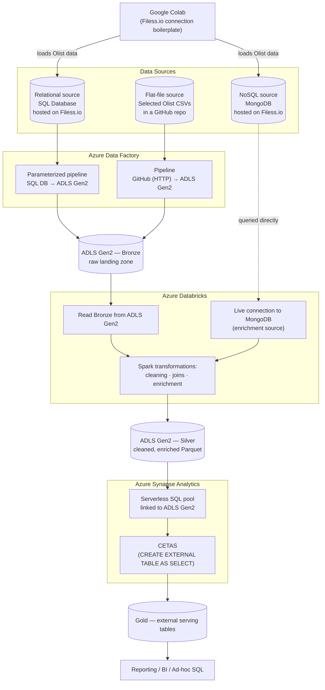

<p align="center">
  
  
  
  
  
  
</p>

<h1 align="center">Azure E-Commerce Data Lakehouse</h1>
<p align="center"><b>An end-to-end Azure lakehouse that ingests three heterogeneous data sources — a relational database, a NoSQL database, and flat files — and turns them into a governed, analytics-ready Gold layer using the Medallion architecture.</b></p>

<p align="center">
  <a href="#-video-walkthrough-phase-by-phase"><b>Watch the full build, phase by phase</b></a> ·
  <a href="#-architecture">Architecture</a> ·
  <a href="#-data-sources">Data Sources</a> ·
  <a href="#-how-to-reproduce-it">How to Run</a>
</p>

---

## Overview

Most "data lakehouse" tutorials start with one clean source. This project deliberately doesn't: it ingests the [Olist Brazilian E-Commerce dataset](https://www.kaggle.com/datasets/olistbr/brazilian-ecommerce) (orders, customers, products, payments, reviews) from **three independent, heterogeneous systems at once** — a relational database, a NoSQL document store, and a set of flat files in a GitHub repo — and reconciles all three into a single star-schema Gold layer, the way a real organization's data actually arrives.

**What it demonstrates:**
- Ingesting and normalizing data across **relational, NoSQL, and file-based** sources into one pipeline
- Building **parameterized, metadata-driven Azure Data Factory pipelines** rather than one pipeline per table
- Using **Azure Databricks / Spark** to join and enrich lake data with a live MongoDB source mid-pipeline
- Serving a governed **Gold layer in Azure Synapse Analytics** via external tables (CETAS) over Parquet in the lake, rather than physically loading a warehouse

---

## Architecture



| Layer | Where | Purpose |
|---|---|---|
| **Bronze** | ADLS Gen2 container | Raw data exactly as copied by ADF — no transformation |
| **Silver** | ADLS Gen2 container (Parquet) | Cleaned, joined, and enriched by Databricks/Spark — includes data pulled live from MongoDB |
| **Gold** | Azure Synapse external tables | Business-ready, queryable star schema, built with CETAS directly over Silver Parquet — no physical warehouse load |

---

## 🔗 Data Sources

This project intentionally mirrors how real companies hold data — scattered across systems — rather than starting from one clean file:

| Source | Type | What it holds | Hosted on |
|---|---|---|---|
| **SQL Database** | Relational | Core transactional Olist tables (orders, customers, payments) | [Filess.io](https://filess.io) free managed DB hosting |
| **MongoDB** | NoSQL / document | Semi-structured data used later to enrich the lake during the Databricks transformation step | [Filess.io](https://filess.io) free managed DB hosting |
| **GitHub repo** | Flat files | A selected subset of Olist CSVs, version-controlled and ingested over HTTP | This repository |

Both databases are seeded from Google Colab using Filess.io's connection boilerplate (`pymysql`/`sqlalchemy` for the SQL side, `pymongo` for MongoDB), so the entire ingestion step runs with no local infrastructure.

---

## 🎥 Video Walkthrough (Phase by Phase)

Every phase of this build was recorded — this is the part most portfolio projects skip, but it's the fastest way to prove the pipeline actually runs end to end rather than just existing as code.

| Phase | What it covers | Watch |
|---|---|---|
| **1 · Ingestion** | Loading Olist data into the SQL and MongoDB instances via Google Colab | [▶ Loom](https://www.loom.com/share/17002c477eb34795a39bb258b5eee76d) |
| **2 · Verification** | Confirming the SQL and NoSQL databases are correctly populated post-ingestion | [▶ Loom](https://www.loom.com/share/0eaf0a63b56e416bb0b9563d0f0cec0d) |
| **3 · Azure Data Factory** | Parameterized pipelines moving Olist data from SQL DB and GitHub into ADLS Gen2 | [▶ Loom](https://www.loom.com/share/542438efded14738b90ffee893a65611) |
| **4 · Bronze Layer** | Reviewing the raw data landed in the ADLS Gen2 storage account | [▶ Loom](https://www.loom.com/share/0e3e4b8bb7d14ffb9b07d19c7305fd6a) |
| **5 · Databricks → Silver** | Connecting Databricks to MongoDB and ADLS Gen2, running Spark transformations, and exporting enriched Parquet to Silver | [▶ Loom](https://www.loom.com/share/d06b3e40c42f443eaee6e613da7d6666) |
| **6 · Synapse → Gold** | Linking the lake to Synapse and building the Gold layer with CETAS | [▶ Loom](https://www.loom.com/share/9482871969aa402dad8cb73d63abd8f3) |

> Consider swapping the plain links above for clickable thumbnail images once this is live — a visual "play" card gets far more clicks on a README than a bare link.

---

## Pipeline Deep Dive

<details>
<summary><b>1️⃣ Ingestion — Google Colab → SQL DB & MongoDB (Filess.io)</b></summary>

`DataIngestionToSQLDBand_MongoDB.ipynb` connects to a Filess.io-hosted SQL database and a Filess.io-hosted MongoDB instance using their boilerplate connection code, then loads the relevant Olist CSVs into each — relational tables into SQL, and a subset modeled as documents into MongoDB. Running ingestion from Colab means zero local setup and an easily shareable, re-runnable notebook.

</details>

<details>
<summary><b>2️⃣ Azure Data Factory — orchestrated, parameterized ingestion</b></summary>

Two ADF pipelines move data into ADLS Gen2:
- A **parameterized Copy Activity pipeline** pulls tables from the SQL Database — parameterizing the source table/query means one pipeline handles every table instead of hand-building a pipeline per table.
- A second pipeline pulls the selected CSVs from this **GitHub repo** over HTTP directly into the lake.

Both land their output untouched in the **Bronze** container of ADLS Gen2.

</details>

<details>
<summary><b>3️⃣ Azure Databricks — transformation, joins & MongoDB enrichment</b></summary>

`Databricks Connection and Transformation Code to ADLS Gen 2 Data.ipynb` does the heavy lifting:
- Mounts/accesses **ADLS Gen2** to read the Bronze data into Spark DataFrames.
- Opens a **live connection to MongoDB**, pulling in the NoSQL data as an additional enrichment source rather than a separate silo.
- Applies Spark transformations — cleaning, type casting, joining the SQL-sourced and MongoDB-sourced data together, and deriving analysis-ready fields.
- Writes the result back to ADLS Gen2 as **Parquet in the Silver container**.

</details>

<details>
<summary><b>4️⃣ Azure Synapse Analytics — the Gold layer</b></summary>

A Synapse workspace is connected directly to the ADLS Gen2 lake (no data duplication into a managed warehouse). From there:
- The Silver Parquet files are explored directly through Synapse's serverless SQL pool.
- **CETAS (`CREATE EXTERNAL TABLE AS SELECT`)** statements build the **Gold** layer as external tables — giving a governed, SQL-queryable schema over the lake while the actual data stays in cheap ADLS Gen2 storage rather than being copied into a dedicated pool.

</details>

---

## Tech Stack

| Category | Tools |
|---|---|
| Ingestion | Google Colab, Python (`pymysql`/`sqlalchemy`, `pymongo`) |
| Source hosting | Filess.io (SQL Database, MongoDB), GitHub (flat files) |
| Orchestration | Azure Data Factory (parameterized pipelines, Copy Activity) |
| Storage | Azure Data Lake Storage Gen2 (Bronze / Silver) |
| Transformation | Azure Databricks, Apache Spark (PySpark) |
| Serving | Azure Synapse Analytics (serverless SQL pool, CETAS, external tables) |
| Architecture pattern | Medallion (Bronze → Silver → Gold) |

---

## Repository Structure

```
Azure-Ecommerce-Data-Lakehouse-Medallion-Architecture/
├── DataIngestionToSQLDBand_MongoDB.ipynb                       # Phase 1 — Colab ingestion into SQL DB + MongoDB
├── Databricks Connection and Transformation Code to ADLS Gen 2 Data.ipynb   # Phase 5 — Spark transform + MongoDB enrichment
├── Detailed Walkthrough to the Whole Project (Loom Videos)     # Phase-by-phase video index (see above)
├── LICENSE
└── README.md
```

> **Suggestion:** this repo currently holds the two notebooks plus the video index. Adding the actual **ADF pipeline JSON exports**, the **Synapse CETAS scripts**, and an architecture diagram image under a `docs/` folder would make the engineering even easier for a reviewer to verify at a glance — happy to help draft those sections once you export them.

---

## How to Reproduce It

1. **Provision free-tier sources** on [Filess.io](https://filess.io) — one SQL Database instance, one MongoDB instance.
2. **Run `DataIngestionToSQLDBand_MongoDB.ipynb`** in Google Colab with your Filess.io connection strings to seed both databases with Olist data.
3. **Set up Azure Data Factory** — create linked services for your SQL Database and this GitHub repo, then build/parameterize the Copy Activity pipelines pointing at an **ADLS Gen2** account (Bronze container as sink).
4. **Set up Azure Databricks** — attach it to the same ADLS Gen2 account, add your MongoDB connection details, then run `Databricks Connection and Transformation Code to ADLS Gen 2 Data.ipynb` to produce the Silver Parquet output.
5. **Set up Azure Synapse Analytics** — link the workspace to the ADLS Gen2 account, then run your CETAS scripts against the Silver container to materialize the Gold external tables.
6. **Query the Gold layer** via Synapse's serverless SQL endpoint for reporting/BI.

---

## Potential Enhancements

- **Automated orchestration end-to-end** — currently Colab ingestion is a manual first step; triggering it (or a scheduled refresh) from ADF via a web activity/Azure Function would make the whole pipeline hands-off.
- **Incremental loads** — parameterized Copy Activities could be extended with watermark columns for incremental ingestion instead of full reloads each run.
- **Data quality checks** — adding validation steps (row counts, null checks, schema drift detection) between Bronze → Silver → Gold, similar in spirit to the checks in my [SQL Data Warehouse project](https://github.com/moizhassan101/SQL-Datawarehouse-Project).
- **Infrastructure as Code** — provisioning the ADF, Databricks, and Synapse resources via Bicep/Terraform instead of manually through the portal, for full reproducibility.
- **CI/CD for notebooks** — linting/testing the Databricks notebook and promoting it through dev/prod via Databricks Repos + Azure DevOps.

---

## License

This project is licensed under the [MIT License](LICENSE).

## Author

**Syed Abdul Moiz Hassan** — [GitHub](https://github.com/moizhassan101)
